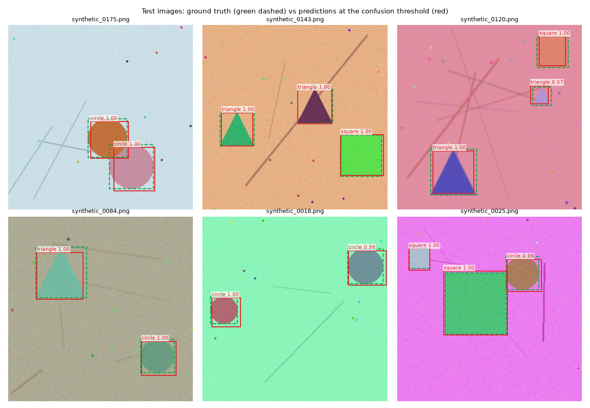

# Detector Training Pipeline

**Tech Boss · fine-tune, evaluate, export.** One command takes a labelled dataset in the YOLO folder layout, validates it, fine-tunes the official TorchVision Faster R-CNN MobileNetV3-Large 320 FPN checkpoint on CPU, evaluates on a held-out split with COCO-style mAP, a confusion matrix and precision-recall curves, exports an ONNX model whose outputs are checked against PyTorch, measures CPU latency, runs ONNX-Runtime-only inference and writes a model card from the measured numbers.

**This is an original pipeline demonstration on synthetic data.** The checked-in numbers describe flat shapes on noisy backgrounds, not any client's photographs. Tech Boss wrote the pipeline, evaluation and export code; the base checkpoint and model code are TorchVision's (BSD-3-Clause). No AGPL component is used.

## Quick start

Python 3.12 in a virtual environment; the pinned versions are in `requirements.txt`. The first training run downloads the official COCO checkpoint (about 74 MB) into the Torch hub cache; `--cache-dir` keeps it outside the repository. Offline unit tests need only the standard library.

```sh
python -m venv .venv
# Activate .venv with the command for your shell.
python -m pip install -r requirements.txt
python -m unittest discover -s tests -v
python pipeline.py --output artifacts --cache-dir ../model-cache
```

The default run generates 200 synthetic images, trains for 8 epochs and writes everything under `artifacts/` (dataset, `model.pt`, `model.onnx`, JSON evidence, plots, `inference/`, `MODEL_CARD.md`). Weights are never committed. On a laptop CPU the whole run takes roughly ten minutes; `--limit 24 --epochs 1 --count 40` gives a one-minute smoke run.

## Bring your own dataset

```
my-dataset/
  classes.txt        one class name per line, in id order
  images/            png, jpg, jpeg, bmp, webp
  labels/<stem>.txt  YOLO lines: class cx cy w h, normalised to [0, 1]
```

```sh
python pipeline.py --data my-dataset --output artifacts --epochs 12 --origin "client X, exported from CVAT 2026-11"
```

Add `--image-size 512` (or more) when the objects are small: the model resizes every image so its shorter side matches this value, and a 12-pixel helmet at 320 becomes a 20-pixel one at 512, at roughly double the latency. The value is stored in the checkpoint and baked into the ONNX graph, so inference needs no extra setting.

This is the layout that Roboflow, CVAT and Label Studio export. An image with no label file counts as a negative image. Validation runs first and lists every problem at once (unknown class id, box outside the image, non-numeric field, orphan label file) instead of failing on the first; training refuses a dataset with problems. The split is a seeded shuffle by image, recorded in `training_log.json`, and a SHA-256 fingerprint of all labels is stored with the checkpoint so evaluation refuses a dataset that changed after training.

## Stages

Each stage is also a standalone CLI; `pipeline.py` writes the exact commands it ran to `artifacts/pipeline.json`.

| Stage | Command | Writes |
|---|---|---|
| Validate + synthesise | `python synthetic.py --output data --count 200 --seed 7` | YOLO-layout dataset, `synthetic.json` |
| Train | `python train.py --data data --output artifacts --epochs 8` | `model.pt` (best epoch by validation mAP@0.5), `training_log.json`, `dataset_report.json` |
| Evaluate | `python evaluate.py --data data --artifacts artifacts` | `evaluation.json`, `test_predictions.json`, `pr_curves.png`, `confusion_matrix.png`, `test_examples.png` |
| Export | `python export.py --data data --artifacts artifacts` | `model.onnx` with class names in its metadata, `export.json` (parity + latency) |
| Infer (no PyTorch) | `python infer.py --model artifacts/model.onnx --input photo.png --output out` | `predictions.json`, annotated PNGs |
| Model card | `python model_card.py --artifacts artifacts --output MODEL_CARD.md` | card filled from the JSON above |

## What the numbers mean

- **mAP@0.5 and mAP@[0.5:0.95]** come from `metrics.py`: class-aware, confidence-ordered, one-to-one greedy matching per image, 101-point interpolated AP, averaged over IoU 0.50 to 0.95. Classes without ground truth in the split are reported as undefined and excluded, never scored zero. Crowd and ignore annotations are not supported; the implementation is unit-tested against hand-computed cases but is not pycocotools.
- **Confusion matrix** at a chosen score threshold and IoU 0.5, matched class-agnostically so a box in the right place with the wrong label lands off-diagonal instead of in two background cells. Rows are ground truth, columns are predictions; the background row is false positives and the background column is misses.
- **Parity** compares ONNX Runtime and PyTorch outputs on the same tensors: maximum box and score differences, label mismatches, detection-count differences, and the blank-image case, which must give zero detections in both.
- **Latency** is the median and p95 of single-image runs on this machine after warm-up, for PyTorch eager and ONNX Runtime at the same thread count. It is a local measurement, not a hardware benchmark.

## Export notes worth knowing

TorchVision detection models export through the TorchScript-based exporter (`dynamo=False`, opset 11); the `torch.export`-based exporter stops on a data-dependent guard inside batched NMS. Two details matter and are handled in `export.py`:

- The graph must be traced on an image that produces proposals. Tracing on random noise follows the empty-proposal branch and yields a graph that fails on real images.
- TorchVision's box decoder reshapes with `(box_sum, -1)`; for an image with no proposals that is an ONNX reshape to `{0, -1}`, which ONNX Runtime rejects. Export uses an equivalent decoder with `-1` on the row axis on a copy of the model, and the parity check runs a blank image to prove the empty path works.

The exported model accepts an RGB float32 CHW tensor in [0, 1] of any size and returns boxes (xyxy in input pixels), 1-based labels and scores; class names travel inside the ONNX metadata, so `infer.py` needs no sidecar file.

## Evidence

`examples/` holds the JSON, plots and annotated outputs of the actual local run described in `DATA_SOURCES.md`; [MODEL_CARD.md](MODEL_CARD.md) was generated from that run. The synthetic dataset is regenerated by seed and not committed.



## Scope and limitations

Synthetic shapes are easy; the scores say the pipeline works, not that the model would work on photographs. No augmentation beyond horizontal flip, no learning-rate search, no tracking, segmentation, drift monitoring or serving. CPU training uses the 320 px model; small objects and fine detail are lost. See the model card for the deployment checklist.
